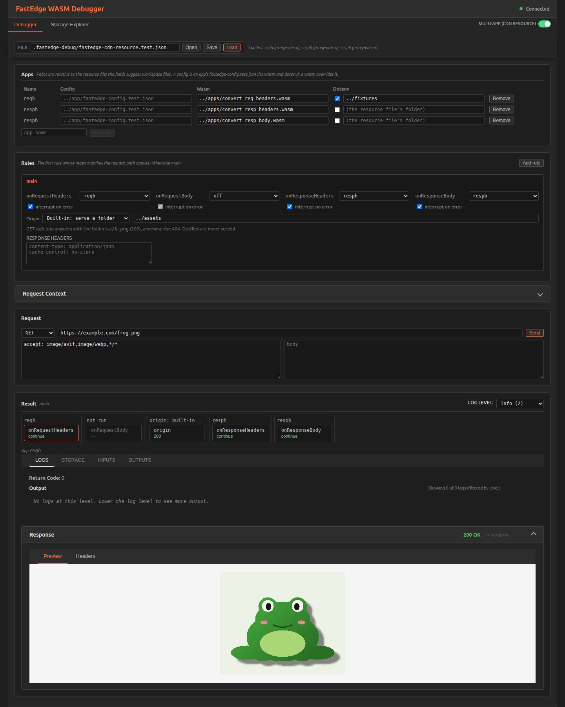
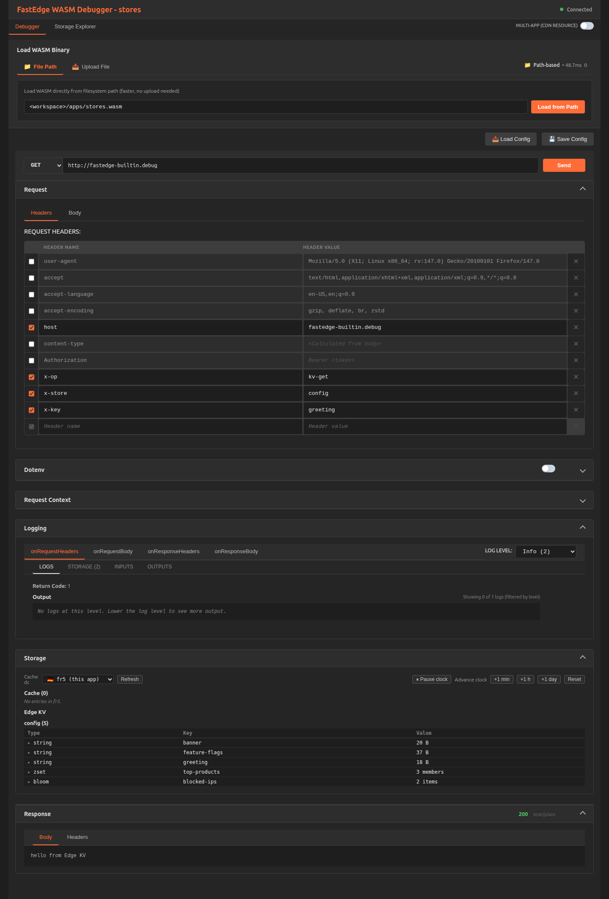
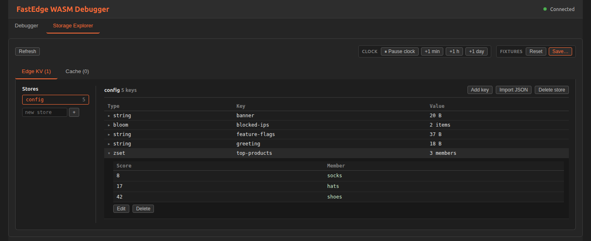

# @gcoredev/fastedge-test

Run and test FastEdge apps on your machine, as they run on the edge. One package gives you:

- a **test runner** for CI and scripts: load a built `.wasm`, send requests, assert on the result;
- a **visual debugger** in the browser (and inside VS Code): send requests, inspect every hook,
  browse the cache and Edge KV.

Both handle CDN apps (proxy-wasm) and HTTP apps; the type is detected from the binary.



## Install

```bash
npm install --save-dev @gcoredev/fastedge-test
```

Requires Node.js 22.13 or later.

## Test runner

```typescript
import { defineTestSuite, runAndExit, runFlow, assertFinalStatus, assertRequestHeader } from '@gcoredev/fastedge-test/test';

await runAndExit(defineTestSuite({
  wasmPath: './build/app.wasm',
  tests: [
    {
      name: 'adds x-custom to the request',
      run: async (runner) => {
        const result = await runFlow(runner, { url: 'https://example.com/page' });
        assertRequestHeader(result.hookResults.onRequestHeaders, 'x-custom', 'expected-value');
      },
    },
    {
      name: 'blocks /admin',
      run: async (runner) => assertFinalStatus(await runFlow(runner, { url: 'https://example.com/admin' }), 403),
    },
  ],
}));
```

Run it with `node`, or use the test framework inside vitest or jest. Start with the
[Quickstart](docs/quickstart.md); the full API is in the [Test Framework](docs/TEST_FRAMEWORK.md)
guide, and the low-level runner in [Runner API](docs/RUNNER.md).

## Debugger

```bash
npx fastedge-debug
```

It prints a URL (`http://127.0.0.1:5179/#token=...`); open it, load a `.wasm` and send a request.
In VS Code, the [FastEdge Launcher](https://github.com/G-Core/FastEdge-vscode) extension builds your
app and opens the same debugger on F5.



- **Using it:** the [Debugger Guide](docs/DEBUGGER_GUIDE.md) walks through every panel; **Help** in
  the debugger's header links to common tasks.
- **Running it:** [Debugger Server](docs/DEBUGGER.md) covers the CLI, ports, environment variables
  and starting it from code.

## A local edge

- **Cache and Edge KV** work locally: seeded from fixture files, shared by every debugger and
  runner in a repository (each test gets fresh stores), and browsable in the Storage Explorer. See [Cache and Edge KV](docs/STORES.md).
- **Client and edge location:** pick where the request comes from and which POP runs the app; geo
  properties and headers follow. See [Test Config](docs/TEST_CONFIG.md#client-and-edge-context).
- **Resources:** run several CDN apps on one resource, one per hook, with rules and an origin. See
  [Resources](docs/RESOURCES.md).
- **Origins:** a built-in origin (echo, fixed response, a folder of files), a real URL, an HTTP app,
  or mocked origins in tests. See [Test Config](docs/TEST_CONFIG.md#origin-cdn) and
  [mockOrigins](docs/TEST_FRAMEWORK.md#mockorigins).



What an app you load can reach on your machine, and which folders the debugger reads, is in
[Security](docs/SECURITY.md).

## Documentation

| Doc | What it covers |
|---|---|
| [Quickstart](docs/quickstart.md) | The debugger, a test suite and the low-level runner, in a few steps |
| [Debugger Guide](docs/DEBUGGER_GUIDE.md) | Using the debugger UI, panel by panel |
| [Debugger Server](docs/DEBUGGER.md) | CLI, ports, environment variables, `startServer()` |
| [Test Framework](docs/TEST_FRAMEWORK.md) | Test suites, assertions, vitest/jest, origin mocking |
| [Runner API](docs/RUNNER.md) | The low-level runner: `createRunner`, `createResource`, request context |
| [Test Config](docs/TEST_CONFIG.md) | `fastedge-config.test.json`: properties, dotenv, client and edge, origins |
| [Cache and Edge KV](docs/STORES.md) | Fixtures, the Storage Explorer, stores in tests |
| [Resources](docs/RESOURCES.md) | Several apps on one CDN resource: hooks, rules and origins |
| [Security](docs/SECURITY.md) | The workspace boundary, allowed folders, what a loaded app can reach |
| [REST API](docs/API.md) | The debugger server's HTTP endpoints |
| [WebSocket](docs/WEBSOCKET.md) | The debugger server's real-time events |
| [Index](docs/INDEX.md) | Every doc and every package export |

JSON Schemas for `fastedge-config.test.json` and the resource file ship in `schemas/`; reference one
with `"$schema": "./node_modules/@gcoredev/fastedge-test/schemas/fastedge-config.test.schema.json"`
for editor autocomplete.

## License

[Apache-2.0](LICENSE)
