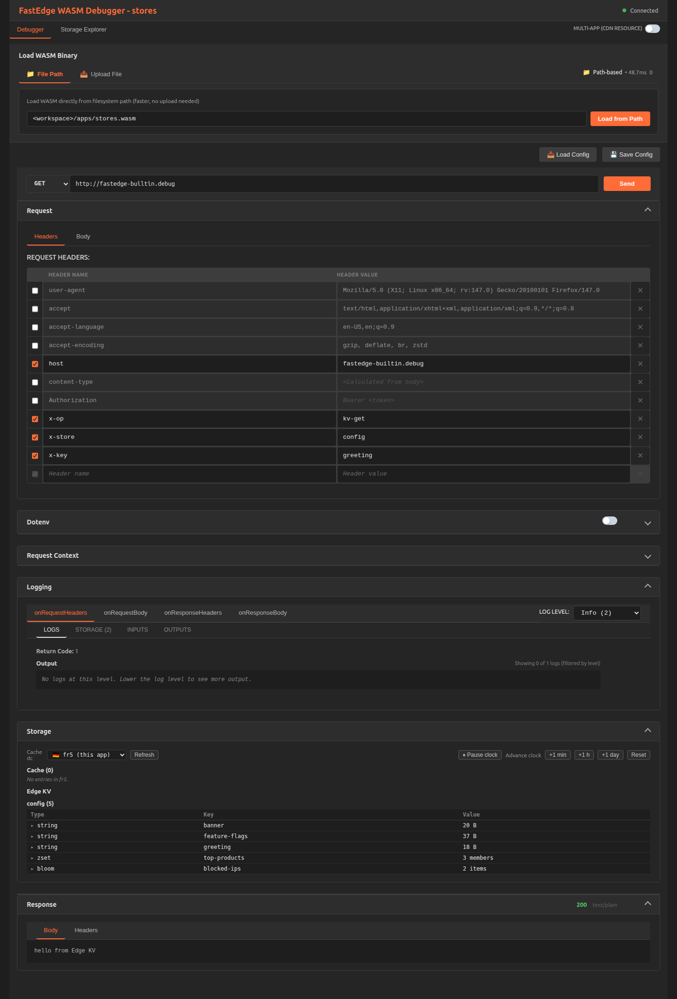
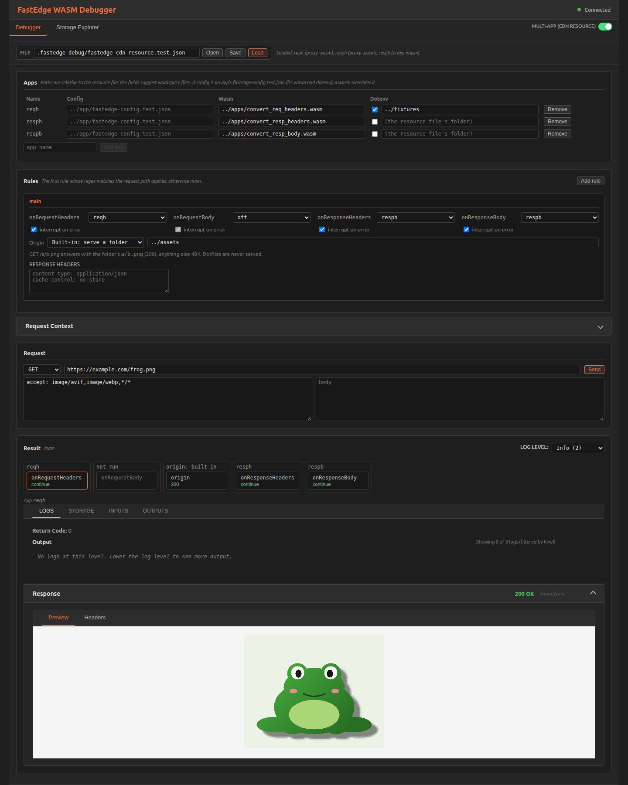
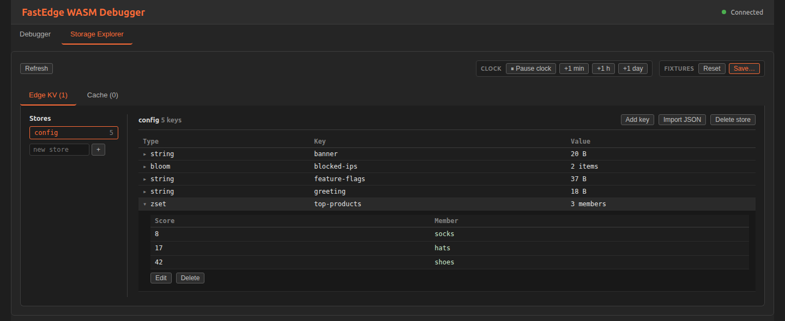

# Debugger Guide

How to use the debugger page: load an app, send requests, read what each hook did, and work with
the cache and Edge KV. For running the server itself (CLI flags, ports, environment variables,
`startServer()`), see [DEBUGGER.md](DEBUGGER.md).

## Start it

```bash
npx fastedge-debug          # in a project that has the package installed
npx -p @gcoredev/fastedge-test fastedge-debug   # anywhere else
```

The server prints a URL with a session token: `Open: http://127.0.0.1:5179/#token=<hex>`. Open
that exact URL; a page opened without the token cannot reach the server. The **workspace** is the
project folder the CLI finds from where you start it, not always that folder itself (the rules are in
[DEBUGGER.md](DEBUGGER.md#cli-usage); `--project-dir` sets it). The debugger reads files inside the
workspace, and anything outside it only after you approve (see
[Folders outside the workspace](#folders-outside-the-workspace)).

In VS Code, the [FastEdge Launcher](https://github.com/G-Core/FastEdge-vscode) extension starts the
same debugger for you: see [In VS Code](#in-vs-code).

The page has two tabs: **Debugger** (one app, or a resource of several) and **Storage Explorer**.

## Load an app



- **File Path:** type a path and click **Load from Path**. `<workspace>` stands for the workspace
  folder (`<workspace>/build/app.wasm`); the field suggests `.wasm` files in the workspace.
- **Upload File:** pick a `.wasm`, or drag one onto the page.

The debugger detects the app type: a CDN app (proxy-wasm) gets the CDN view, an HTTP app gets the
HTTP view. The title shows the app's name.

## Send a request

The bar under the loader holds the method, the URL and **Send**. Below it, the **Request** panel
has the headers (tick a row to send it) and the body.

- **CDN apps** start on `http://fastedge-builtin.debug`, the built-in origin: no network, it answers
  with a JSON echo of the request it received. With no origin set in
  [Request Context](#request-context), any other URL sends the request on to that real origin after
  the request hooks.
- **HTTP apps** start on `http://test.localhost/`: the request goes straight to your app.

**Send** runs the whole flow. For a CDN app that is `onRequestHeaders`, `onRequestBody`, the origin,
`onResponseHeaders` and `onResponseBody`, in order, as on the edge.

## The panels

Each panel collapses; open the ones you need.

### Dotenv

Off by default. Turn it on to load the app's environment variables and secrets from `.env` files
(`.env`, `.env.variables`, `.env.secrets`). **Dotenv path** is the folder they are in; empty means
the app's root folder. Turning it on or off reloads the app.

### Request Context

Where the request comes from and where the app runs:

- **Client:** a preset (`de`, `nl`, `us`) plus field overrides (IP, ASN, country, city, region,
  continent, latitude, longitude). These become the request's geo properties and headers.
- **Edge:** a preset plus overrides for the POP that runs the app (dc, hostname, region, country,
  city). The **dc** is also the cache bucket the app uses.
- **Origin** (CDN apps): where the origin response comes from. **The request URL** (the default)
  fetches the URL, or answers locally when it is the built-in one. Any other choice (a JSON echo of
  the request, a fixed response, a folder of files, or a URL) applies whatever the request URL is:
  the URL is then only what the client asked for, and its path and query go to that origin.
- **Properties** (CDN apps): explicit property values. They win over the client settings.

### Logging

The app's output, by hook (CDN apps) with a tab per hook, filtered by **Log level**. Each hook has:

| Tab | Shows |
|---|---|
| Logs | The hook's return code and its log lines |
| Storage | Every cache and Edge KV call the hook made, with its result |
| Inputs | What the hook received: headers, body, and properties before it ran |
| Outputs | What the hook changed: headers and body, marked against its inputs |

HTTP apps have **Logs** and **Storage** only.

### Storage

The cache and Edge KV as the app sees them, refreshed after every request:

- **Cache dc** picks the bucket to show; the app's own dc is marked "this app".
- **Pause clock** stops time for every app, so TTLs only move with **+1 min**, **+1 h**, **+1 day**.
- **Reset** empties the cache (every dc) and re-seeds Edge KV from the fixture files.
- **Edge KV** lists each store with its keys; expand a key to see its value.

The [Storage Explorer](#storage-explorer) edits the same data.

### Response

The final response: status, content type, **Body** and **Headers**. HTML and images also get a
**Preview**.

## Save and load a config

**Save Config** writes the current app's path, the request, properties, dotenv, request context,
origin and log level to a `fastedge-config.test.json`; **Load Config** reads one back and loads its `.wasm`. The same file
drives tests (`loadConfigFile()`); its format is in [TEST_CONFIG.md](TEST_CONFIG.md). An app loaded
with **Upload File** is saved by its file name only, which Load Config looks for in the workspace:
load the app by path when you want the config to find it again.

In a browser, the file picker hides where a config came from, so a relative `dotenv.path` in it is
read against the workspace and the page warns you. In VS Code the extension's picker knows the
folder, and relative paths work.

## Multi-app (CDN resource)



Turn on **Multi-app (CDN resource)** to run one request through several CDN apps, one per hook,
as a CDN resource does on the edge. The view edits a resource file; its format is in
[RESOURCES.md](RESOURCES.md).

- **File:** the resource file, `.fastedge-debug/fastedge-cdn-resource.test.json` by default.
  **Open** reads it into the editor, **Save** writes it, **Load** loads its apps.
- **Apps:** a name, then a `.wasm`, an app's `fastedge-config.test.json`, or both, and an optional
  dotenv folder. Paths are relative to the resource file.
- **Rules:** `main` sets which app runs each hook and the origin. A rule matches the request path
  with a regex and overrides them; the first matching rule applies. **Interrupt on error** decides
  what happens when that hook's app fails: the client gets 531, or the request goes on as if the
  hook had not run.
- **Origin:** a built-in responder (echo, fixed response, a folder of files), a URL, or an HTTP app
  of the resource (the way a CDN resource can use a FastEdge app as its origin).
- **Request Context:** one client and one edge for the whole resource.
- **Request:** method, URL, headers (one `name: value` per line) and body. **Send** saves and loads
  the file first when it has changed.

The **Result** strip shows each hook with the app that ran it and how it ended, and the origin's
status. Click a hook to see its Logs, Storage, Inputs and Outputs. The response is below.

An HTTP app cannot run on a hook. While one is loaded in the single-app view, unload it to use
multi-app.

## Storage Explorer



The cache and Edge KV that every debugger and runner in this repository share (tests run by the
test framework get fresh stores per test instead). See [STORES.md](STORES.md) for where they live
and how they are seeded.

- **Edge KV:** the stores on the left. Create a store, then **Add key** (a string, sorted set or
  bloom filter), **Import JSON**, or **Delete store**. Expand a key to edit or delete it. Apps can
  only read Edge KV, as on the edge; this is where you change it.
- **Cache:** one bucket per dc. **Add entry**, or edit and delete entries; TTLs count down with the
  clock.
- **Clock:** pause it, or advance it, for every app at once.
- **Fixtures:** **Reset** goes back to the fixture files (`fixtures/stores/`): the cache is emptied
  and Edge KV re-seeded, and unsaved edits are lost. **Save…** writes Edge KV to the fixture files,
  showing the changes first.

## Folders outside the workspace

The debugger reads only inside the workspace, unless you list other folders (`--allow <dir>`, or
the `fastedge.debugger.allowedFolders` setting in VS Code). The page lists them; each is read only
after you approve it, once per debugger session:

- the first read from a folder asks you, in the terminal that started the debugger or in a VS Code
  dialog, and the page says it is waiting for your answer;
- **Ask to read it** asks up front, so the folder's files appear in the path suggestions;
- a refused folder stays refused until the debugger restarts.

The page itself cannot approve a folder. Why, and what a loaded app can reach, is in
[SECURITY.md](SECURITY.md).

## In VS Code

The FastEdge Launcher extension runs this debugger in a VS Code panel:

- **F5** (or **Debug: FastEdge App (Current File)** / **(Package Entry)**) builds your app and opens
  the debugger with it loaded.
- **FastEdge: Load in Debugger** on a `.wasm` file, and **FastEdge: Load Config in Debugger** on a
  `*test.json` file, load them into the debugger.
- Load Config and Save Config use VS Code's file dialogs, starting in your app's folder.
- Approvals for folders outside the workspace come as VS Code dialogs.

## See also

- [DEBUGGER.md](DEBUGGER.md): running the server, CLI flags, ports, environment variables
- [TEST_CONFIG.md](TEST_CONFIG.md): the config file the debugger loads and saves
- [RESOURCES.md](RESOURCES.md): the resource file behind multi-app
- [STORES.md](STORES.md): fixtures and stores in tests
- [SECURITY.md](SECURITY.md): the workspace boundary and allowed folders
